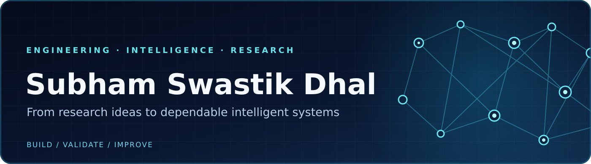

  

  <h3>AI/ML Engineering · Software Engineering · Data Science · Applied Research</h3>

  
<strong>Building intelligent systems that are useful, dependable, and experimentally sound.</strong>

  
  
  

---

### 👋 About me

I build **production-minded software and applied AI/ML systems**, with experience spanning enterprise backends, computer vision, spatio-temporal forecasting, causal inference, and trustworthy machine learning.

My work connects **research quality** with **engineering discipline**: reproducible experiments, secure APIs, model validation, automated testing, and thoughtful system design. I enjoy taking technically demanding problems from a rigorous idea to a working end-to-end system.

### 🚀 Selected public engineering work

<table>
  <tr>
    <td width="50%" valign="top">
      <h3><a href="https://github.com/subhamsdhal/UrbanGraph-Intelligence">UrbanGraph Intelligence</a></h3>
      
<strong>Spatio-temporal forecasting · Geospatial AI · Urban analytics</strong>

      
End-to-end work across geospatial graph construction, multivariate forecasting, interactive analytics, experiment tracking, and artifact provenance.

      
<code>Python</code> <code>PyTorch</code> <code>GNNs</code> <code>FastAPI</code> <code>React</code> <code>Docker</code>

    </td>
    <td width="50%" valign="top">
      <h3><a href="https://github.com/subhamsdhal/AMS-ASSET-MANAGEMENT-SYSTEM">Asset Management System</a></h3>
      
<strong>Enterprise applications · Secure workflows · Database integrity</strong>

      
Asset lifecycle workflows with role-based authorization, audit logging, service-layer validation, transaction safeguards, and QR-based verification.

      
<code>Java</code> <code>Jakarta EE</code> <code>JSP/Servlets</code> <code>MySQL</code>

    </td>
  </tr>
</table>

### 🔬 Other selected work and research interests

- **Computer vision and video analytics:** Real-time object detection, multi-object tracking, event-driven alerting, and evidence integrity in the **NETRAKSH** system. Project details are summarized here without linking to non-public source code.
- **Causal machine learning:** Treatment-effect estimation, Double Machine Learning, doubly robust estimation, robustness analysis, and policy optimization in **CausaPilot / CausalForge AI**.
- **Trustworthy tabular ML:** Dataset-shift evaluation, calibration, drift detection, and reproducible benchmarks in **TrustTab-X**.
- **Research themes:** Graph learning, temporal forecasting, reliable ML, causal inference, security-aware AI systems, and reproducible experimentation.

### 🧰 Technical toolkit

**Software & backends:** REST APIs · authentication and RBAC · database design · secure workflows · CI/CD · automated testing  
**AI/ML:** PyTorch Geometric · graph neural networks · gradient boosting · time-series forecasting · probability calibration · out-of-distribution evaluation  
**Research practices:** Reproducible experiments · statistical evaluation · data lineage · uncertainty analysis · model integrity

### 📌 What I value in a project

**Clear problem framing** → **thoughtful architecture** → **measurable evaluation** → **secure, maintainable delivery**.

I'm interested in opportunities to contribute to impactful software and AI systems, and in research collaborations grounded in careful experimentation and meaningful results.

  Thanks for visiting — explore the work, or reach out to start a conversation.

